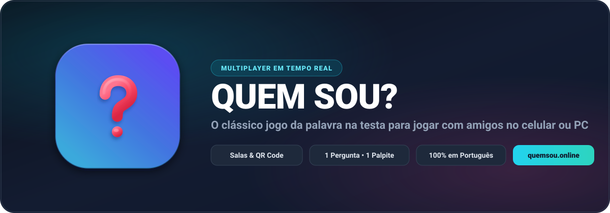

<div align="center">
  <a href="https://quemsou.online">
    
  </a>

  <br />
  <br />

  <p>
    <a href="https://quemsou.online">
      
    </a>
    
    
    
  </p>
</div>

# 🎭 Quem Sou? — Multiplayer Online em Tempo Real

Uma versão web multiplayer em tempo real do clássico jogo **"Quem Sou?"** (*Heads Up* / *Palavra na Testa*), com dinâmica de salas privadas, fila circular de palavras não resolvidas, turnos estritos e chat de palpites com validação automática.

Construído com **Node.js**, **WebSockets (Socket.io)** e **Tailwind CSS**, 100% responsivo (**Mobile-First**), em **Português do Brasil (pt-BR)**.
Domínio oficial de produção: **[https://quemsou.online](https://quemsou.online)** (Hospedado no Render com DNS e Proxy Cloudflare).

---

## 🌟 Principais Funcionalidades

### 1. Conectividade e Salas em Tempo Real
- **Criação de Salas**: O jogador Host cria uma sala e o sistema gera automaticamente:
  - Um **Código de Sala** curto e legível (ex: `K9X2P`).
  - Um **Link Único de Convite** com botão de cópia com 1 clique (preservando IP local em redes Wi-Fi privadas e utilizando `https://quemsou.online` em produção).
  - Um **QR Code Dinâmico** gerado no backend (`/api/qr`), permitindo que amigos entrem instantaneamente pelo celular apenas apontando a câmera!
  - **Tutorial Integrado**: Botão de ajuda `?` na tela inicial e no lobby explicando as 9 regras do jogo em modal acessível.
- **Fase Secreta de Sugestão de Palavras (Preparação)**:
  - Ao clicar em "Iniciar", o jogo entra primeiro na tela de **Sugestão de Palavras**.
  - Cada jogador digita uma palavra secreta e uma categoria para colocar na testa de um adversário.
  - O sistema mantém o que cada um escreveu sob sigilo total.
- **Sorteio com Desarranjo (Derangement) Matemático**:
  - **Regra de Ouro**: O backend executa um algoritmo de desarranjo cíclico que garante que **NENHUM jogador receba a própria palavra que ele mesmo escreveu**.
  - Cada participante recebe secretamente uma palavra sugerida por outro jogador da sala.
- **Sincronização Segura da "Palavra na Testa"**:
  - Todos os adversários conseguem ver a palavra na testa dos outros participantes.
  - O jogador da vez recebe apenas `???` em seu próprio dispositivo, tornando impossível trapacear inspecionando o tráfego de rede ou console.

### 2. Ciclo de Turno Estrito e Fila Circular
- **Fluxo do Turno**:
  1. O jogador ativo formula **1 pergunta** no chat.
  2. Os demais participantes respondem no chat ou via botões rápidos (**👍 SIM**, **👎 NÃO**, **🤔 TALVEZ**).
  3. A primeira resposta válida libera a decisão do jogador ativo de enviar **1 palpite** ou **passar a vez**.
- **Fila de Palavras Não Resolvidas**:
  - Se errar o palpite, passar a vez ou o tempo esgotar, o jogador vai para o final da fila e **mantém a mesma palavra**.
  - Se acertar, o jogador sai da fila de palpites daquela rodada, mas continua apto a responder às perguntas dos outros.
  - A rodada só termina quando todos os jogadores elegíveis acertarem suas palavras.
- **Pontuação Justa e Equilibrada**:
  - **Base decrescente por tentativa da rodada**: `Math.max(0, 110 - (tentativa * 10))`.
  - **Bônus de agilidade de tempo**: `Math.round(100 * (tempoRestante / 60))` com divisor fixo de 60s e clamp `[0, 60]`.

### 3. Interface 100% Responsiva (Mobile-First & Desktop)
- **Celular (Smartphones)**: Layout vertical com botões grandes de toque fácil, cronômetro central de barra fluida, cartão de testa em destaque e caixa de chat sempre acessível.
- **Computador (Monitores)**: Layout amplo dividido em 3 colunas proporcionais:
  - **Esquerda (3/12)**: Placar e classificação ao vivo com avatares e pontuação.
  - **Centro (4/12)**: Palco da rodada com o cartão de palavra na testa, cronômetro regressivo com alerta visual e botões de resposta rápida.
  - **Direita (5/12)**: Chat global de palpites com histórico colorido, rolagem interna inteligente e validação em tempo real.

### 4. Conteúdo 100% em Português (pt-BR)
- Banco de palavras estruturado em `data/palavras.json` com dezenas de opções distribuídas em categorias populares:
  - 🌟 **Celebridades** (Silvio Santos, Pelé, Anitta, Neymar, Ayrton Senna, etc.)
  - 🎬 **Personagens de Desenho** (Bob Esponja, Mickey Mouse, Pica-Pau, Goku, etc.)
  - 🦁 **Animais** (Capivara, Ornitorrinco, Leão, Bicho-Preguiça, etc.)
  - 📦 **Objetos** (Liquidificador, Celular, Guarda-chuva, etc.)
  - 🚀 **Profissões** (Astronauta, Bombeiro, Detetive, etc.)

---

## 🚀 Como Rodar Localmente

```bash
# 1. Instalar dependências
npm install

# 2. Executar suíte de testes automatizados (37 testes)
npm test

# 3. Iniciar servidor em desenvolvimento
npm start
```

Acesse `http://localhost:5173`.
